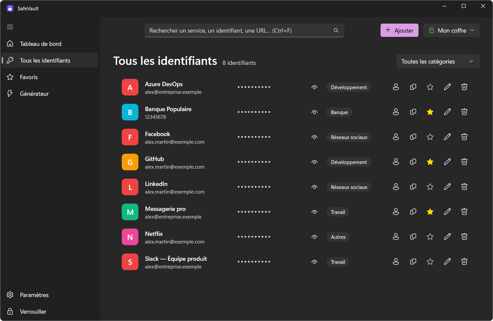
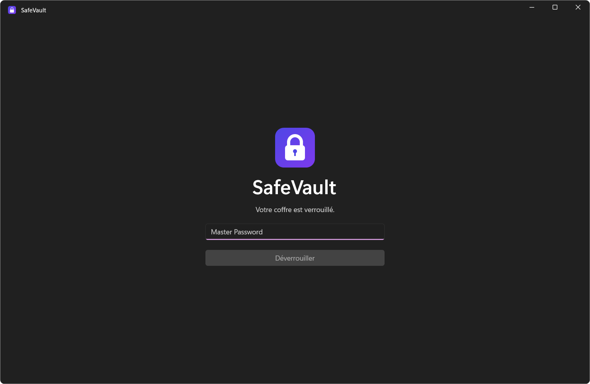
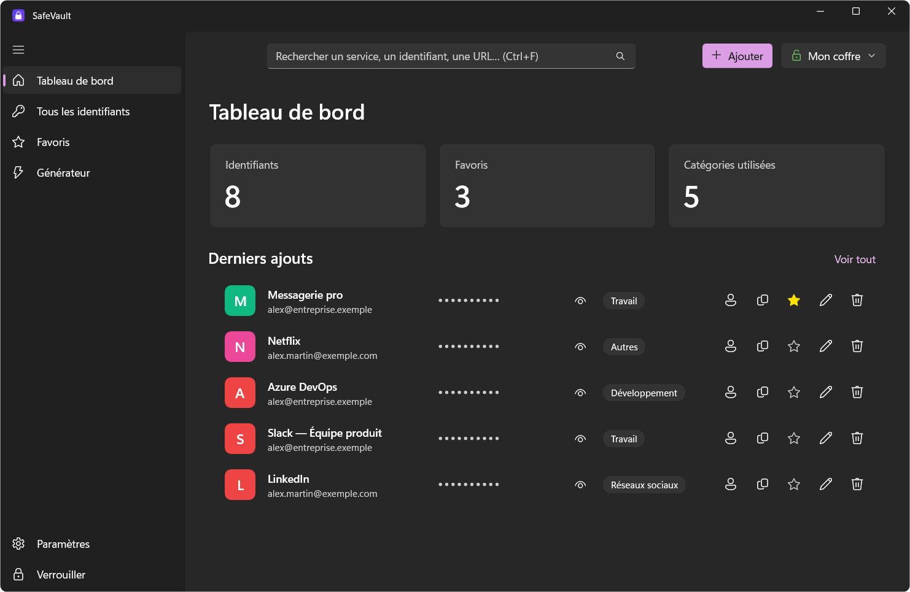
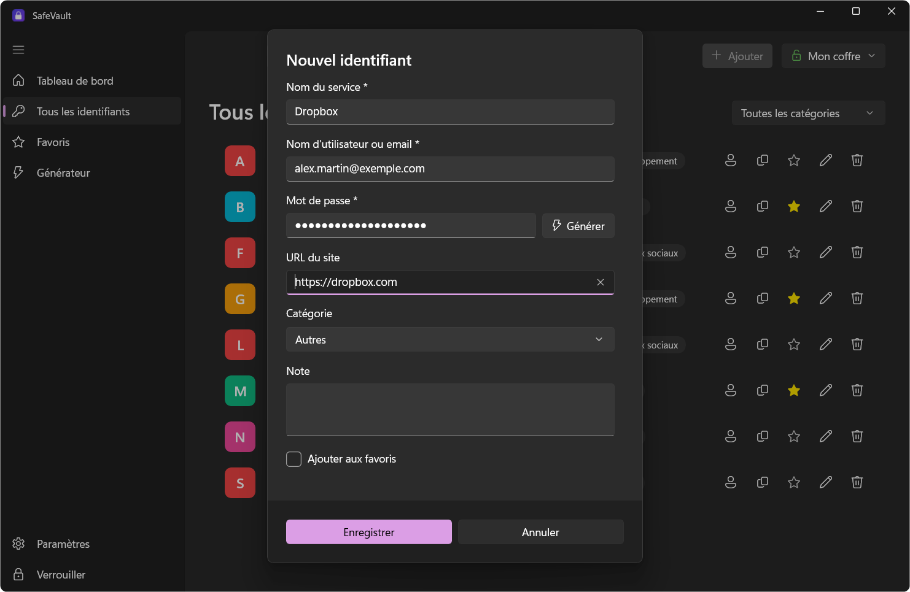
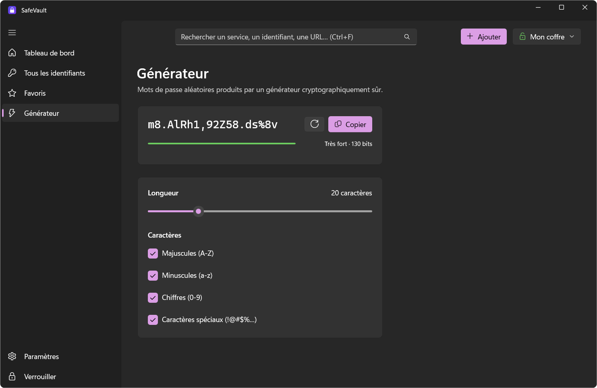
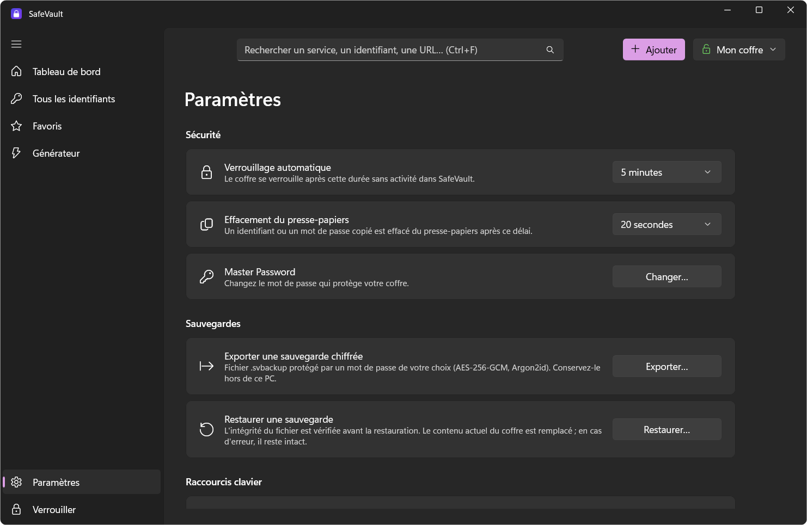

<p align="center">
  
</p>

<h1 align="center">SafeVault</h1>

<p align="center">
  Gestionnaire de mots de passe <strong>local et hors ligne</strong> pour Windows.<br />
  Aucun serveur, aucun compte, aucune télémétrie.
</p>

<p align="center">
  
</p>

## Présentation

SafeVault regroupe vos identifiants dans un coffre chiffré, stocké uniquement sur votre ordinateur et protégé par un seul mot de passe principal, le **Master Password**.

L'objectif de la version 1.0 n'est pas de concurrencer les grands gestionnaires. Elle vise un périmètre réduit mais **irréprochable dans son fonctionnement et sa sécurité**.

## Fonctionnalités

| | Fonctionnalité |
|---|---|
| 🔐 | **Coffre-fort** : création au premier lancement, déverrouillage par Master Password, verrouillage manuel et automatique après inactivité |
| 🗂️ | **Identifiants** : ajout, consultation, modification et suppression (service, identifiant, mot de passe, URL, note) |
| 🎲 | **Générateur** : mots de passe aléatoires et cryptographiquement sûrs, longueur et jeux de caractères au choix |
| 🔎 | **Organisation** : recherche instantanée (insensible aux accents), tri alphabétique, catégories et favoris |
| 👁️ | **Consultation sécurisée** : mots de passe masqués, affichage temporaire, copie avec effacement automatique du presse-papiers |
| 💾 | **Sauvegarde** : export chiffré et restauration avec vérification d'intégrité |

Raccourcis clavier : `Ctrl+F` pour rechercher, `Ctrl+N` pour ajouter, `Ctrl+L` pour verrouiller.

## Captures d'écran

| Déverrouillage | Tableau de bord |
|---|---|
|  |  |
| **Ajout d'un identifiant** | **Générateur** |
|  |  |
| **Paramètres et sauvegardes** | |
|  | |

*Les captures utilisent des données fictives.*

## Installation

SafeVault fonctionne sous **Windows 10 (version 1809) ou Windows 11, en 64 bits**. Les deux livrables embarquent .NET et le Windows App SDK : il n'y a rien d'autre à installer.

### Version portable

1. Décompressez `SafeVault-1.0.0-win-x64-portable.zip` dans un dossier de votre choix.
2. Lancez `SafeVault.exe`.

### Paquet MSIX

Le paquet est signé avec un **certificat de test auto-signé**. Windows doit d'abord lui faire confiance. Dans un PowerShell **ouvert en administrateur** :

```powershell
Import-Certificate -FilePath .\SafeVault.cer -CertStoreLocation Cert:\LocalMachine\TrustedPeople
```

Ouvrez ensuite `SafeVault_1.0.0.0_x64.msix` et cliquez sur **Installer**.

> Une diffusion à grande échelle demanderait un certificat de signature de code délivré par une autorité reconnue, ou une publication sur le Microsoft Store.

### Où sont mes données ?

Le coffre est enregistré dans `%LOCALAPPDATA%\SafeVault\vault.db`, quelle que soit la version installée. Désinstaller l'application **ne supprime pas** le coffre.

La page **Paramètres → À propos → Ouvrir l'emplacement** ouvre ce dossier.

> ⚠️ **Il n'existe aucun moyen de récupérer un Master Password oublié.** Exportez régulièrement une sauvegarde chiffrée et conservez-la hors de votre PC.

## Compilation

**Prérequis :**
- [.NET SDK 10](https://dotnet.microsoft.com/download) ;
- Windows 10 ou 11 ;
- recommandé : Visual Studio 2026 avec la charge de travail *Développement d'applications WinUI*.

```powershell
git clone https://github.com/Isaac-nova08/safevault.git
cd safevault
dotnet build SafeVault.sln
dotnet test tests\SafeVault.Tests
```

Dans Visual Studio, ouvrez `SafeVault.sln`, définissez **SafeVault.App** comme projet de démarrage, puis appuyez sur `F5`. En développement, l'application s'exécute sans empaquetage.

### Produire les livrables

```powershell
.\build\publish.ps1 -CreateTestCertificate
```

Le script lance les tests, puis dépose dans `artifacts\` :
- le paquet MSIX signé ;
- le certificat `SafeVault.cer` ;
- la version portable `.zip`.

L'option `-CreateTestCertificate` crée un certificat de test « CN=SafeVault » dans le magasin de l'utilisateur, ou réutilise celui qui existe. Pour signer avec votre propre certificat, utilisez plutôt `-CertificateThumbprint <empreinte>`.

Les logos sont générés par `dotnet run tools\generate-assets.cs`.

## Architecture

```
SafeVault.sln
├── src/
│   ├── SafeVault.App        Présentation : WinUI 3, MVVM (CommunityToolkit.Mvvm), vues et navigation
│   ├── SafeVault.Core       Métier : coffre, identifiants, sauvegardes, paramètres, politique de mot de passe
│   ├── SafeVault.Security   Cryptographie : Argon2id, AES-256-GCM, clé de coffre, générateur, format de sauvegarde
│   └── SafeVault.Data       Stockage : SQLite (Microsoft.Data.Sqlite), données déjà chiffrées
├── tests/SafeVault.Tests    xUnit : sécurité, métier, stockage et sauvegardes
├── build/publish.ps1        Production du paquet MSIX et de la version portable
├── tools/                   Génération des logos
└── docs/                    Rapport de recette et captures d'écran
```

| Couche | Responsabilité | Dépend de |
|---|---|---|
| **App** | Interface, ViewModels, services d'interface (navigation, dialogues, presse-papiers, verrouillage automatique) | Core, Security, Data |
| **Core** | Règles métier et services applicatifs ; définit l'interface de stockage `IVaultStore` | Security |
| **Security** | Primitives cryptographiques, sans dépendance à l'interface ni au stockage | Argon2id (Konscious) |
| **Data** | Implémentation SQLite de `IVaultStore` ; ne manipule que des données chiffrées | Core |

Le moteur de sécurité et le métier sont des bibliothèques .NET indépendantes de Windows, testées sans l'interface.

### Modèle de données

| Table | Contenu |
|---|---|
| `vault_meta` | Version, sel et paramètres Argon2id, clé de coffre enrobée |
| `categories` | Réseaux sociaux, Travail, Banque, Développement, Autres |
| `entries` | GUID, catégorie, favori, dates, et `payload` chiffré (service, identifiant, mot de passe, URL, note) |
| `settings` | Délai de verrouillage automatique, délai d'effacement du presse-papiers |

## Sécurité

En résumé :
- une **clé de coffre aléatoire de 256 bits** chiffre chaque entrée en **AES-256-GCM** ;
- cette clé est elle-même chiffrée par une clé dérivée du Master Password avec **Argon2id** (64 Mio, paramètres calibrés pour la machine) ;
- le Master Password n'est **jamais stocké**.

Les choix cryptographiques, le format des fichiers, le modèle de menaces et les **limites connues** sont détaillés dans [SECURITY.md](SECURITY.md).

## Tests

```powershell
dotnet test tests\SafeVault.Tests
```

143 tests xUnit couvrent :
- la dérivation de clé (vecteur de la RFC 9106) ;
- le chiffrement et l'unicité des nonces ;
- le générateur ;
- le CRUD ;
- l'absence de données en clair dans la base ;
- la détection des altérations ;
- l'export et l'import des sauvegardes.

La vérification fonctionnelle complète par rapport au cahier des charges est décrite dans [docs/RECETTE.md](docs/RECETTE.md).

## Confidentialité

SafeVault ne collecte **aucune donnée** et n'effectue aucune connexion réseau. Voir [PRIVACY.md](PRIVACY.md).

## Feuille de route

Ces fonctionnalités sont hors du périmètre de la version 1.0 :
- **V2** : synchronisation, authentification biométrique, extension de navigateur, détection des fuites, fichiers chiffrés ;
- **V3** : applications mobiles, partage sécurisé, collaboration.

## Licence

Distribué sous licence MIT. Voir [LICENSE](LICENSE).
